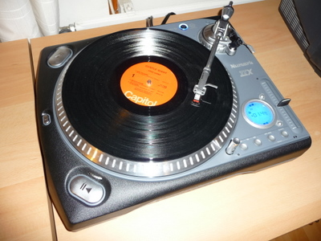

Vihdoin se tuli hankittua, uusi levysoitin. Edellinen levysoitin oli jo kauan ollut käyttämättömänä pitkälti syystä että nykyisessä kotiteatterivahvistimessa ei ollut levysoittimelle liitäntää, olisi tarvinnut ostaa väliin RIAA vahvistin. Siitä 1970-luvulla ostamastani Pioneerista oli jo kerran aiemmin lahonnut kuminauhakin, jonka avulla lautasta pyöritettiin, old school! Mutta hyvin tuo palveli.

Tein mieluummin päivityksen nykyaikaan ja ostin suoravetoisen levysoittimen, jossa on sisäänrakennettuna esivahvistus, eli piuhat vaan kiinni vahvistimeen ja pelit soimaan! :)  
Ensimmäiseksi lautaselle Gentle Giant.  
  
  
  
Täytyy sanoa, että aika nostalgiset fiilikset, kun pitkästä aikaa kuulee viimevuosituhannen rahisevaa analogista musiikkia.

Soitin tarjoaa tietysti myös USB-liitännän, joten sitä voisi vaikkapa siirtää vanhaa vinyylikokoelmaa mp3-maailmaan, tai mitäs jos ottaisi taas itselleen uuden ammatin: DJ ???

Lisätietoja laitteesta: [http://www.numark.com/ttxusb](http://www.numark.com/ttxusb)
