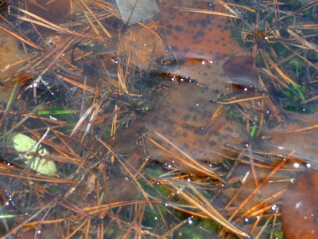
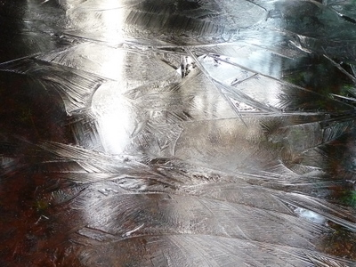
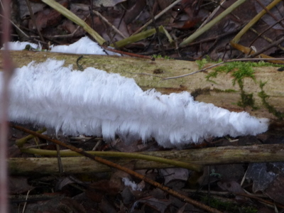
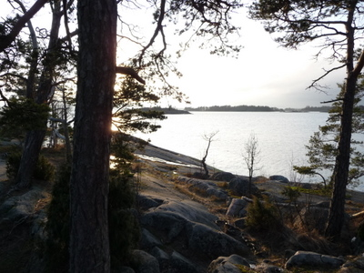
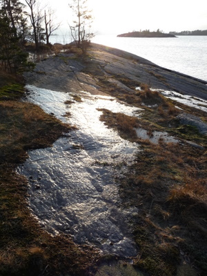

Pitkästä aikaa aurinkoa taivaalta. Pimeyden voimat on lannistettu muutamaksi tunniksi ja se mahdollistaa ulkoilun kiikareiden, kameroiden ja kavereiden kanssa.

  
Entinen kesä veden alla  
  
  
Hyytynyt vesi  
  
  
Pukin parta kasvaa puussa  
  
  
Vastavaloa  
  
  
Kiiltokallio
