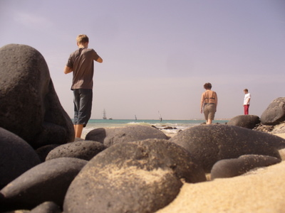
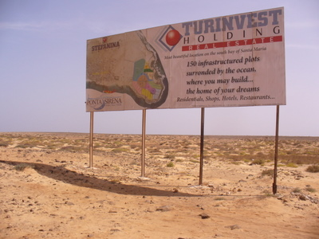
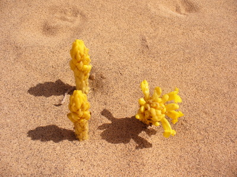
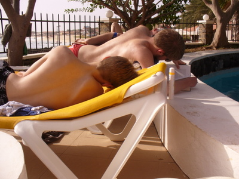

Kävimme myös Santa Marian itäpuolella, karua kivikkorantaa, tuulisempaa ja suurempia aaltoja.  

Koko Sal -saaren eteläosa tuntui olevan mielettömän rakennusboomin alla. Hotelleja ja loma-asuntoja oli joka paikassa rakenteilla ja uusia oli tulossa kuten kylttikin kertoo.  

Karun hiekan keskeltä putkahteli siellä täällä keltaisia kukkia.  

Kuuman hiekalla kävelyn jälkeen oli hyvä lepuuttaa uima-altaalla hotellin web-kameran kuvassa, josta poikien serkku meidät plokkasikin.  

