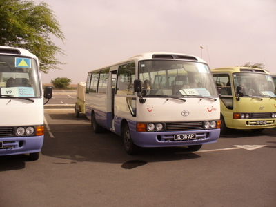
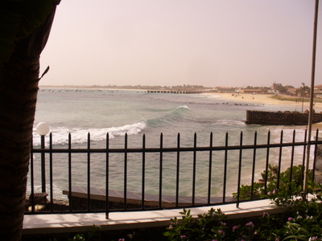
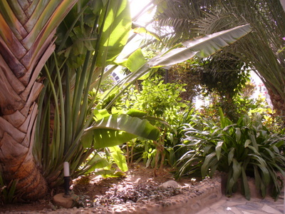
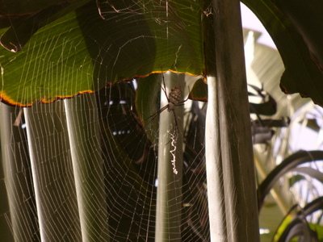

Kymmenen tunnin puuduttavan lentotunnin jälkeen vihdoin perillä, valmiina alas lämpöön Salin saarelle Kap Verdeen:  
  

Puhelin päälle, niin mutta eihän se DNA toimi täällä :) , tuli heti mieleen se wanha lastenlaulu: Telefooni Afrikassa:

> Elefantti wanha setä kommervenkit keksi  
> tietää viisas varsin hyvin mikä keino tepsii:  
> häntä pannaan toiseen korvaan, toinen kärsää käyttää  
> ja tuo uusi telefooni kaiket toiveet täyttää!

tai jotain sinnepäin... Toisaalta, mitäpä sitä nyt lomalla puhelimella tekisi? Muulla perheellä on onneksi toimivat puhelimet (Sonera ja Elisa toimivat), joten kiinni saa jos on tarvetta.

Minibussilla tuhatta ja sataa kohti saaren eteläosan turistikaupunkia: Santa Maria  
  

[Hotelli Odjo d'Aqua](http://www.odjodagua.net/en/hotel.html) oli aivan meren rannalla, jatkuva melko kova meren kohina rannan puolella.  

  
Näkymä hotellihuoneesta sisäpihalle

  
Kotipihan ikioma hämähäkki, vartalo peukalon kokoinen plus sitten ne koivet.
