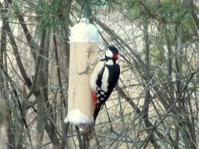
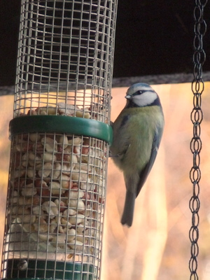

Muutaman kävelylenkin ja keittiön ikkunatiirailun ansiosta on muutama lintukin jo nähty ja kuvattu. Piharuokinnassa on vieraita:  
  
Käpytikka talitangon tahdissa  
  
  
Sinitiainen valitsee pähkinää.

Vuoden 2009 alun lajilistaa: varis, naakka, harakka, kesykyyhky, kalalokki, sinisorsa, kyhmyjoutsen, harmaahaikara, viherpeippo, varpunen, talitiainen, sinitiainen, mustarastas, räkättirastas, käpytikka, fasaani

Pitäisi kai lähteä oikein retkelle, eikä tyytyä tähän passivitarkkailuun.
