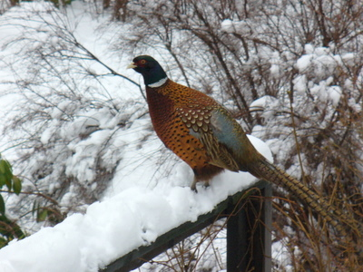
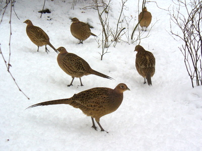

Taas tänä talvena on pihallamme seurana ikioma kanalauma, suurimmillaan 21 fasaania. Viisi kukkoa, ja kuusitoista kanaa. Ovat kesyjä ja oppineet kuulemaan verannan liukuoven ja muovisen pähkinpussin äänistä, että nyt on ruoka-aika. Kipittävät kiltisti lähes jalkojen juureen odottamaan antimia.

Yksi kukoista on selvästi kingi, neljä muuta ovat vain apu/varakukkoja.

\[caption id="attachment\_986" align="alignnone" width="400" caption="fasaanikukko"\]\[/caption\]

\[caption id="attachment\_987" align="alignnone" width="400" caption="fasaanikanat"\]\[/caption\]
