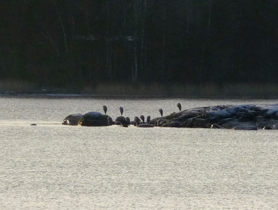
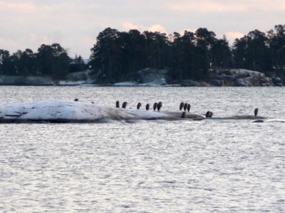

En tiedä osaavatko harmaahaikarat lukea kalenteria, kun ovat jääneet Aurinkolahdelle talveksi luodolle kyhjöttelemään. Kyllähän sinne aurinko paistaa, mutta kylmää kyytiä se on tammikuussa. Vuosaaren Aurinkolahden edustan luodolla niitä on ollut vaihteleva määrä loppusyksystä alkaen, enimmillään 13. Tänään näkyvissä oli kymmenen lintua ja kai ne sieltä luodolta sitten ruokaakin saavat, kun eivät näy lentävän sieltä minnekään.

Toinen hieno lintuhetki oli tänään tuossa luodon päällä ja ympäristössä, kun kaksi isokokoista kanahaukkanaarasta kisailivat meren yllä. Toinen yritti sitkeästi saada varista meren päällä kiinni melkein siinä onnistuenkin, mutta aina viime tingassa variksen onnistui tehdä nopea väistöliike ja haukan kynnet sutivat vain ilmaa. Harvoin näkee näin hienosti parin-kolmen minuutin jahtauskohtausta saati sitten kahta kanahaukkanaarasta yhtäaikaa. Tätä en saanut kameralla ikuistettua, kun piti kiikaroida variksen selviytymistaistelua.
