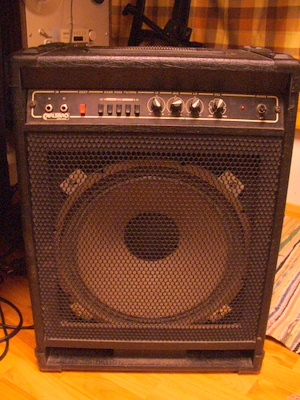

Myydään tarpeettomana bassovahvistin: Carlsbro Cobra, 90W kombo

\[caption id="attachment\_991" align="alignnone" width="300" caption="Carlsbro Cobra Bass - 90W kombo"\]\[/caption\]

Tekniset tiedot:

- Carlsbro Cobra Bass
- 90 Wattia, transistori
- 15 tuuman kartio
- 2 sisäänmenoa: lo ja hi
- Deep -kytkin
- 5 -alueinen Band Pass Filter
- 3-alueinen ekvalisaattori; hi, mid, lo
- voluumisäätö
- Direct out

Laite on täysin toimiva, ikää on arvioilta 20-25 vuotta, ei tarkkaa tietoa.  On ollut pääosin treenikäytössä ja muutamalla keikallakin se on palvellut kelvollisesti.

Hinta vain 50 €, joten pankinjohtajan puheille ei ole luultavasti tarvetta. Jos kiinnostaa, ota yhteys minuun kommentoimalla viestiä tai ...

**Kaupaksi meni, kiitos!**

En postita, vaan nouto käteinen kourassa Vuosaaresta, Helsingistä.
