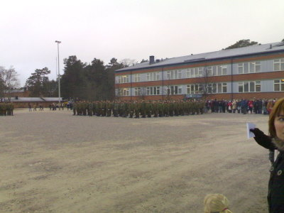
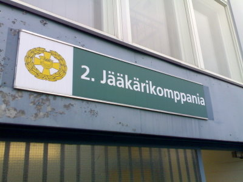
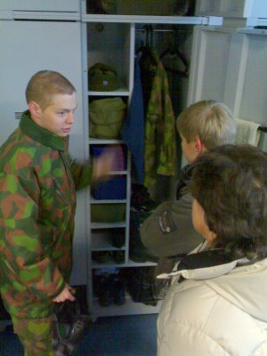
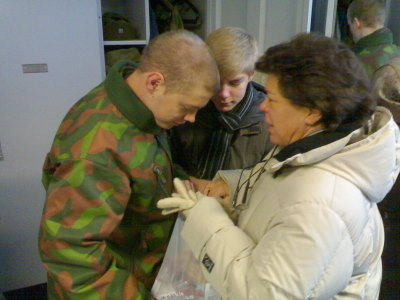

Helsingin Santahaminassa vietettiin tänään varusmiesten omaistenpäivää. [Kaartin Jääkärirykmentin](http://www.mil.fi/maavoimat/joukot/kaartjr/index.dsp) varusmiehet seisoivat ryhdikkäästi kentällä kun äidit, isät, veljet, siskot, poikakaverit, tyttöystävät jne. olivat tulleet heitä tervehtimään.

Yksikön komentaja piti tervetuliaispuheen, jonka jälkeen varusmiehet pääsivät omaisten kanssa kertoilemaan ensimmäisen viikon kokemuksistaan. Mekin siirryimme tietysti heti 2. Jääkärikomppanian rakennuksen luo alokas Väisästä tervehtimään.

Sisällä tarkastettiin ensin tupa, sänky ja tietysti myös kaappi.

Sitten tuliaiset.

Sitten olikin aika tutustua lähipiiriin, kuten sotilaskodin munkkeihin ja kahveihin, ottaa osaa arpajaisiin, tutustua varusmiesten aseisiin ennen ja nyt, sekä ruokailuun. Aika kiva päivä, alokaskin tuntuu itse olevan olosuhteet huomioon ottaen tyytyväinen. Kyllä se 9-12 kuukautta siinä menee kuin siivillä.
