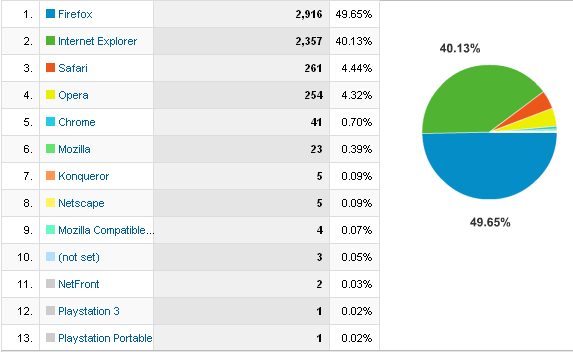
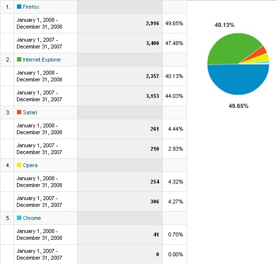
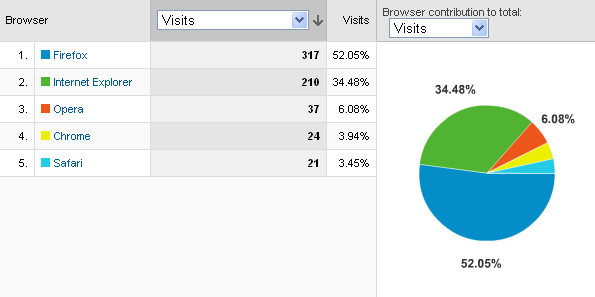

On aika tarkastella tämän sivuston kävijöiden selaimia, ensin koko vuoden 2008 tilastot:  
  
siis Firefox on ykkönen ja IE on yhtä selvästi toisena.

Vuodessa on asetelmat hieman muuttuneet verrattuna 2007:ään. Neljä kärkiselainta muodostaa selkeän raon muihin, nyt uutena on mukana Chrome.  
  
IE on menettänyt nelisen prosenttiyksikköä ja sen ovat vieneet Firefox, Safari ja Chrome.

Viimeisimmän joulukuun 2008 tilastot näyttävät Firefox ja Chrome kirineen kaikkein kovimmin:  

Web-kehittäjää kiinnostanee tieto, että IE:n viitossukupolvea ei enää käyttäjillä ole käytössä. Koko vuonna 2008 vain 4 vierailua versiolla 5.5, onneksi. Sama trendi myös työpaikan tilastoissa. Nyt kun vielä pääsisi tuosta kuutosesta eroon, sitä käyttää vielä 31%, seiskaversiota melkein 68%, loput on uusimman 8:n käyttäjiä.
