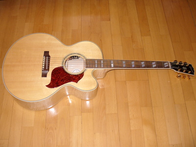

Kauan on kärsitty vilua ja nälkää...tai oikeastaan kauan on rämpytetty sitä sun tätä.  
Olen soitellut todella pitkään Yamahan FS-575E elektroakustisella kitaralla, paremman puutteessa. Siitä kerkesi jo vuosien aikana kuolemaan elektroniikkakin, joten pelkkänä akustisena se on palvellut jostain 1980-luvulta asti, en oikein muistakaan ostoa tarkasti. Musiikki Fazer Aleksanterinkadulla oli ostopaikka. Nyt se joutaa varakitaraksi, venekitaraksi, kakkoskitaraksi tai jotain.

Sain vihdoin aikaiseksi oikean kitaran oston. Tein tutkivaa taustatyötä melko pitkään etukäteen, ennenkuin ostin. Vuosien varrella on tullut koesoiteltua Helsingin soitinliikkeissä siellä tarjolla olleita kitaroita. Koesoittorumba aktivoitui radikaalisti viime syksynä. On kokeiltu runsaasti eri merkkejä ja malleja; Yamaha, Guild, Martin, Gibson, Taylor, Takamine, Seagull, Schecter, Larrivee, jne. Ongelma täällä Suomessa on tietysti pienehkö tarjonta eri malleissa, läheskään kaikkia malleja ei ole saatavilla kokeltavaksi. Niin ja hinnassa on aina Suomi-lisää, jopa useita satoja euroja. Eniten Suomen tarjonnassa harmitti, ettei Gibsonilta löytynyt kuin muutama malli koesoitettavaksi.

Kaikki koesoitetut kitarat tuli myös tutkittua netissä tarkemmin valmistajien kotisivujen avulla, joissa parhaissa on tarjolla jopa ääninäytteitä eri malleista. Toiseksi tuli luettua erilaisia arvosteluja. Niitä tuli luettua myös sellaisten mallien osalta joita ei päässyt koesoittamaan. Erityisen hyödyllisiksi osoittautuivat tietysti kotimaiden [Muusikoiden.net](http://muusikoiden.net/), mutta ehkä eniten luin [Harmony-Central](http://reviews.harmony-central.com/reviews/Guitar) sekä [Musicians Friend](http://www.musiciansfriend.com//) -sivustoja.

Lopulta päädyin tilaamaan Saksasta "sokkona" kitaran koesoitettavaksi, olihan siinä 30 päivän palautusoikeus. Jos ei miellytä niin postissa vaan takaisin, on se halvempaa kuin matkustaa Saksaan koesoittamaan. No, kitara tuli UPS:n avulla eilen, ja illan koesoiton myötä myös hyväksi havaittu, sen aion myös pitää.

Gibson J-185 EC  
  
Kitaranomistajaa kiinnostaa yleensä tarkemmat tiedot omasta soittopelistään, sarjanumero paljastaa onneksi jotain. Niinpä minäkin tarkistin oman kitarani valmistusajan [Gibson Serial Number Search](http://www.gibson.com/en-us/Support/SerialNumberSearch/) -sivulta.

Lisätietoja ja ääninäytteitä [Gibson J-185 EC](http://www2.gibson.com/Products/Acoustic-Instruments/Jumbo/Gibson-Acoustic/J-185-EC.aspx) -kitaran kotisivuilta.
