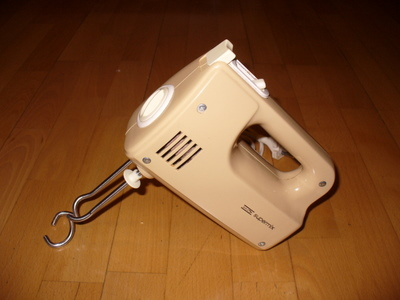

Tässä vatkatessani vaniljakastiketta vaahdoksi puolukkapiirakalle tajusin yht'äkkiä minkälainen nostalgialaite on kädessäni. Entisessä Itä-Saksassa eli DDR:ssä valmistettu AKA Supermix vatkain.

\[caption id="attachment\_1012" align="alignnone" width="400" caption="AKA Supermix vatkain"\]\[/caption\]

Muuttaessani viime vuosituhannella pois kotoa kimppaan Helin kanssa sain isältäni lähtiäislahjaksi tämän vatkaimen. Vuosi oli muistaakseni 1981. Isäni kai ajatteli, että on edes jotain ruuanlaittovälinettä, ettei poika heti nälkään kuole. Vatkain on edelleen toimintavarma ja palvellut uskollisesti kaikki nämä vuodet, siis kohta jo 30 vuotta. Siinä on pullataikinakoukut, vaahdotusvispilät sekä päätyyn kiinnitettävä erillinen sauvasekoitinosa, joka tosin on kadonnut. Tällä on hoidettu kaikki tämän perheen vatkaukset ruuanlaitossa. Se on jykevä, yli kilon painoinen, siis sisällä on rajusti metallia rattaissa. Päädyssä olevassa kyltissä lukee, ettei sitä saa käyttää kuin 10 minuuttia kerrallaan, tulisiko sen jälkeen kärähdys? No, näin ei ole koskaan käynyt.

Pikainen Google-haku tuotti laitteesta myös hauskoja tuloksia. Näitä on mm. myynnissä eBayssa, eikä hinta ole vielä ihan antiikkitavaratasolla. Siis näitä on muillakin kuin minulla, ja se kertonee jotain laitteen kestosta, liekö suunniteltu sotilaskäyttöön ;)
