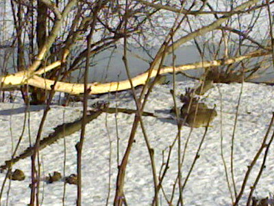

Mahtava ulkoiluilma ja varma kalansaalis Hakaniemen hallissa.  Kuhafileitä tarttui pankkikortti -nimiseen pyydykseen.

Kanit ovat vallanneet keskustan puistot.  Vähän väliä Töölönlahtea kiertäessä oli puita ja pensaita, joista oli kaluttu kuoret pois. Sääli keskustan puistoja, tuo söpö tuholainen saa aikaan pahaa jälkeä.

\[caption id="attachment\_1015" align="alignnone" width="400" caption="Kanit ja tuhot"\]\[/caption\]

Tarvitaan lisää kettuja,  huuhkajia sekä kanahaukkoja jne. sekä tietysti puiden suojaamista talven ajaksi. Onkohan kanille ehkäisypillereitä?
