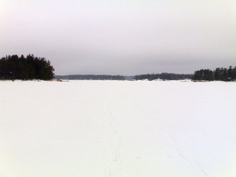

Aivan pakko oli repiä iltapäivä vapaaksi, vaikka tekemättömiä juttuja olisi vaikka muille jakaa. Oli korkea aika kavuta suksille ennenkuin meren jää alkaa sulaa. Siispä matkalle Sipoon Hitåsta kohti etelää, Bärgarholmenin vierestä Möholmeniin grillipaikalle. Hieman hitaasti huonosti liukuvilla puusuksilla, perintö-Lampisilla, mutta eihän meillä kiire mihinkään kaverin kanssa ollutkaan.

\[caption id="attachment\_1018" align="alignnone" width="400" caption="Näkymä Möholmenin vierestä pohjoiseen"\]\[/caption\]

Matkalla oli tietysti hyvä varustus, eli grillimakkaraa, salaattia, patonkia, olutta, kahvia, suklaata ja keksejä.

Mikä hiljaisuus saaristossa onkaan, tekee hyvää mielelle!

Nuori merikotkakin nähtiin pariin otteeseen, toisen kerran aivan yli lentävänä matalalla puiden latvojen korkeudella, niin että paljain silmin oikeastaan näki paremmin kuin kiikareilla.
