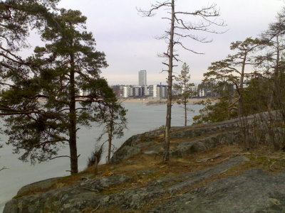
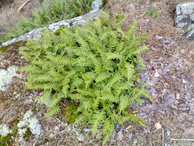
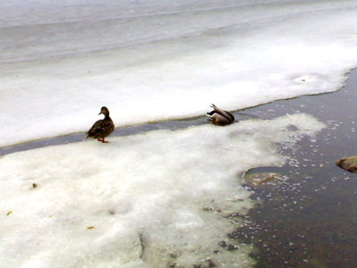
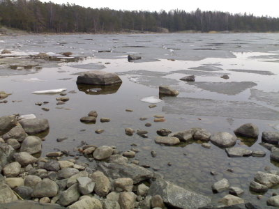

\[caption id="attachment\_1032" align="alignnone" width="400" caption="Vuosaarenselkä on vielä jäässä"\]\[/caption\]

Uutelassa on käytännöllisesti katsoen kaikki lumet sulaneet. Meren jää on tummaa ja kohta poissa.

\[caption id="attachment\_1033" align="alignnone" width="400" caption="Kallioimarre pirteänä"\]\[/caption\]

Kallioimarre on jo vauhdikkaasti kasvussa.

\[caption id="attachment\_1036" align="alignnone" width="400" caption="Sorsat lounaalla"\]\[/caption\]

Sorsat saavat vihdoin muutakin syötävää kuin homeista pullamössöä ihmisiltä.

\[caption id="attachment\_1034" align="alignnone" width="400" caption="Uutelan makkaranpaistopaikan edessä jäät ovat jo lähdössä."\]\[/caption\]

Kevät on vauhdissa. Metsässä ja aukeiden reunoilla soi mukava linnunlaulujen kakofonia: peippo, punakylkirastas, mustarastas, sepelkyyhky ja tiaiset pitävät kilvan reviiristään huolta.
