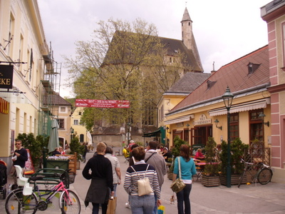
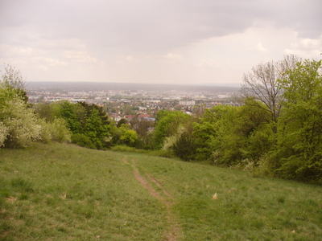
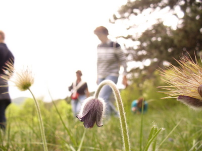
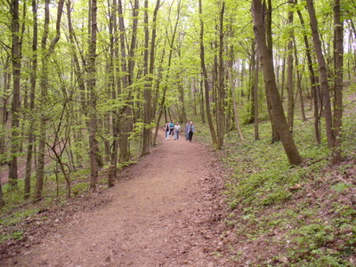
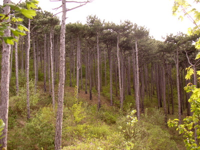

Päivä Wienin ulkopuolella sukuloimassa.

\[caption id="attachment\_1056" align="alignnone" width="400" caption="Näkymä Mödlingistä"\]\[/caption\]

Kohti kahvilaa ja sitten luontoon.

\[caption id="attachment\_1057" align="alignnone" width="400" caption="Näkymä Wienerwaldin rinteiltä kohti Slovakiaa ja Unkaria"\]\[/caption\]

\[caption id="attachment\_1058" align="alignnone" width="400" caption="Kylmäkukka"\]\[/caption\]

\[caption id="attachment\_1059" align="alignnone" width="400" caption="Välillä on lehtipuumetsää"\]\[/caption\]

\[caption id="attachment\_1060" align="alignnone" width="400" caption="Sitten on myös männikköä"\]\[/caption\]

\[caption id="attachment\_1061" align="alignnone" width="400" caption="Ravintola "Käpy""\]\[/caption\]

Muutaman tunnin ulkoilun ja kävelyn jälkeen oli jo jano ja nälkä. Täällä annoskoko oli mahtava, hyvä jos hengissä selvisi enää eteenpäin.
