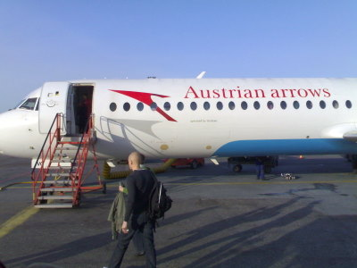
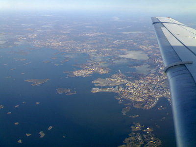
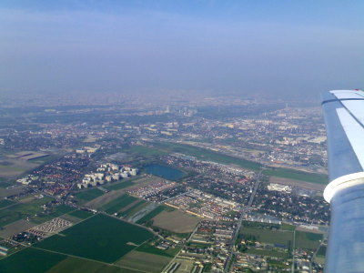
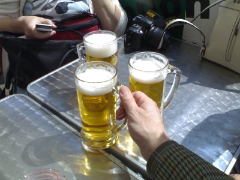

Aamusella kentälle ja koneeseen.

\[caption id="attachment\_1044" align="alignnone" width="400" caption="Fokker odottaa"\]\[/caption\]

Mukavan aurinkoinen aamu.

\[caption id="attachment\_1045" align="alignnone" width="400" caption="Helsinki yläilmoista"\]\[/caption\]

Jäät ovat pääosin lähteneet. Näkemiin Helsinki!

\[caption id="attachment\_1046" align="alignnone" width="400" caption="Wien yläilmoista"\]\[/caption\]

Kahden tunnin ja vartin lennon jälkeen aletaan olla perillä. Wienissä on jo kesä, maisema viheriöi.

\[caption id="attachment\_1047" align="alignnone" width="400" caption="Katukahviloita riittää Wienissä, ja hyvää olutta!"\]\[/caption\]

Kesäkelit, +20 astetta, ja makea jano :)
