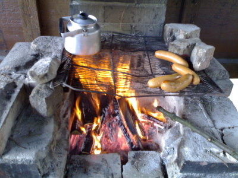

Ulkoilua mukavassa kevätsäässä Porkkalan kärjen ulkoilualueella.

\[caption id="attachment\_1040" align="alignnone" width="400" caption="Lämmin ruoka ja kahvi valmistumassa"\]\[/caption\]

Enemmän panostettiin eväisiin ja lepuuttamiseen, mutta lintujakin nähtiin: kurkia, kuoveja, västäräkkejä, peippoja, lokkeja, sotkia, telkkiä, koskeloita,  kiuruja, siis juuri kaikkia perinteiseen kevääseen kuuluvia lajeja.

Voi kuinka hyvä on olla lomalla :)
