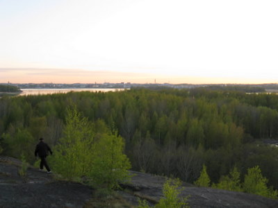
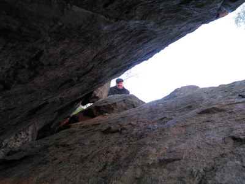
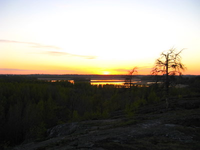

Pientä fiilistelyä Herttoniemen vanhan hyppyrimäen (jo puretun) kalliolla. Täällä tuli istuttua iltaa kavereiden ja kitaroiden kera 70-luvulla. Sama meno tuntuu jatkuvan nytkin, nuorisoa bilettämässä kalliolla, vaan kenelläkään ei ole kitaroita...

\[caption id="attachment\_1095" align="alignnone" width="400" caption="Alkukesän vehreyttä illan hämärässä Herttoniemessä"\]\[/caption\]

Oli myös käytävä kurkkaamassa kalliojyrkänteellä olevaa halkeamaa, jota pitkin pikku-poikana peloissaan kiipeiltiin ylös ja alas.

\[caption id="attachment\_1096" align="alignnone" width="400" caption="Halkeama Herttoniemen kallioilla"\]\[/caption\]

Auringonlasku on aina hieno!

\[caption id="attachment\_1097" align="alignnone" width="400" caption="Auringonlasku hyndän kaltsilta"\]\[/caption\]
