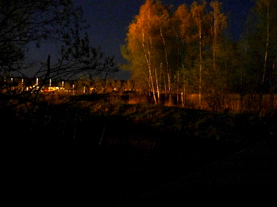
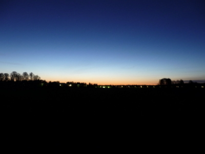
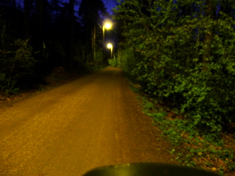
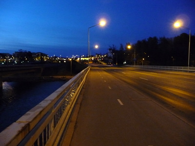

Pyöräretki lintuja kuuntelemaan, äänittämään ja yökuvia napsimaan. Reitti: Vuosaaresta metrolla Herttoniemeen, josta pyörällä Kulosaareen, Kalasatamaan, Kyläsaareen, Vanhankaupunginlahtea kiertäen taas Herttoniemeen, josta Roihuvuoren ja Marjaniemen kautta kotiin Vuosaareen. Kesto noin 5 tuntia kuvaus-, äänitys- ja juomataukoineen . Alkumatkasta ei yölaulajia juuri äänessä mutta tyllejä Arabianrannan nurmikoilla ja rannalla.

Pitkospuita pitkin Lammassaareen. Ruokokerttusia, kolme luhtahuittia . Harmi että tuulee, se haittaa äänitystä. Lintutornin vieressä satakieli ja kauempana vielä toinen. [Kuuntele lintutornin satakieltä](https://teuvovaisanen.fi//wp-content/uploads/2009/05/satakieli-lammassaari-helsinki.mp3).

Lammassaaresta rantaa pitkin kohti vanhaa Viikin puhdistamoa, kolme satakieltä lisää ja ruokokerttusia.

\[caption id="attachment\_1078" align="alignnone" width="400" caption="Sähkövalo loimuttaa puut entisen puhdistamon reunalla"\]\[/caption\]

Hakalanniemen lintutornissa on rauhallista kun pahin tuuli menee ylitse. Aamuyön olutkin maistuu hyvältä. Hauet molskivat kaislikossa ja töyhtöhyypät ja sorsat pitävät meteliä. Kaupunki kohisee taustalla.

\[caption id="attachment\_1079" align="alignnone" width="400" caption="Auringon valo loimottaa Viikin peltojen yli pohjois-koillisesta"\]\[/caption\]

Retken kahdeksas satakieli näppäilee Hakalanniemen itä-osassa. Kaksi satakieltä lisää vielä Herttoniemen osuudella Vanhankaupunginlahtea.

\[caption id="attachment\_1083" align="alignnone" width="400" caption="Herttoniemen ja Mölylän välinen tie"\]\[/caption\]

Herttoniemestä puro pulputtaa iloisesti alas rinnettä. [Kuuntele puroa](https://teuvovaisanen.fi/wp-content/uploads/2009/05/puro.mp3).

Saunalahdella huutelee kaulushaikara verkkaiseen tahtiin, rastaatkin ovat jo heränneet ja aloittelevat lauluaan. [Kuuntele Saunalahden kaulushaikara](https://teuvovaisanen.fi/wp-content/uploads/2009/05/kaulushaikara.mp3).

Herttoniemi - Vuosaari välillä vielä yhdeksän satakieltä lisää, koko reissulla siis yhteensä 19 satakieltä. Punarinnat ja rastaat täydessä laulutouhussa.

Aamu jo sarastaa, nukkumaan.

\[caption id="attachment\_1082" align="alignnone" width="400" caption="Aamu sarastaa Vuosaaren sillalla"\]\[/caption\]
