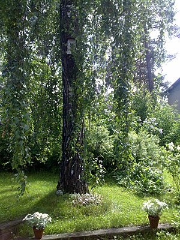

Tänä vuonna Juhannus tulee vietettyä kaupungissa. Hetkittäin jopa aurinko paistoi, vaan keskimäärin aika kehno keli. Tuulee ja on kylmä.

\[caption id="attachment\_1164" align="alignnone" width="300" caption="Juhannus kaupungissa 2009"\]\[/caption\]

Onneksi tunnelmaa luo ikioma takapihan Juhannuskoivu.

No ensi viikoksi on luvassa kesäisempiä lämpötiloja, aika hyvä juttu näin loman kannalta.

Hyvää Juhannusta!
