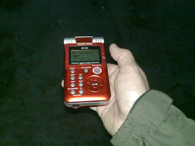
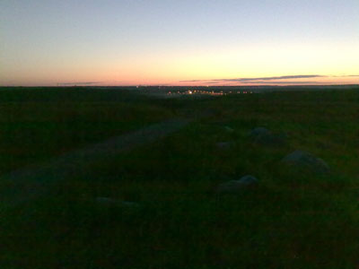
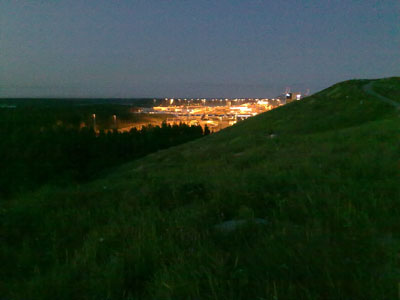

Kesäyö on parhaimmillaan, valoa riittää ja lintuja myös. Reitti: Vuosaari - maankaatopaikka - Pornaistenlahti - Talosaari - Vuosaari Kuuntelusaalis: Kuusi ruisrääkkää, yksi viiriäinen,  yksi luhtakerttunen  ja tietysti yön vakioääniä kuten, satakieliä, ruokokerttusia, taivaanvuohia, kohinaa kaupungin teiltä ja satamasta.

Tällä kertaa linnut olivat hieman etäällä, mutta jotain tuli talteen äänistä kuitenkin, kuuntele:

- [ruisrääkät ja taivaanvuohi](https://teuvovaisanen.fi/wp-content/uploads/2009/06/ruisraakat-ja-taivaanvuohi.mp3)
- [ruisrääkkä ja luhtakerttunen](https://teuvovaisanen.fi/wp-content/uploads/2009/06/ruisraakka-ja-luhtakerttunen.mp3)

\[caption id="attachment\_1174" align="alignnone" width="400" caption="Tascam GT-R1 on äänien tallentaja"\]\[/caption\]

\[caption id="attachment\_1170" align="alignnone" width="400" caption="Vuosaaren täyttömäki pohjoiseen"\]\[/caption\]

\[caption id="attachment\_1171" align="alignnone" width="400" caption="Vuosaaren täyttömäki etelään"\]\[/caption\]
