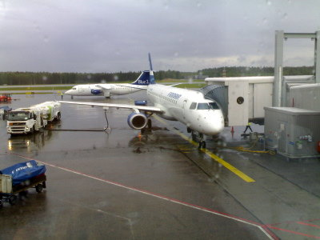
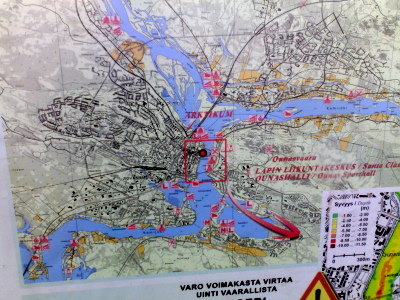
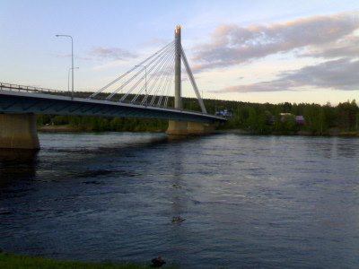
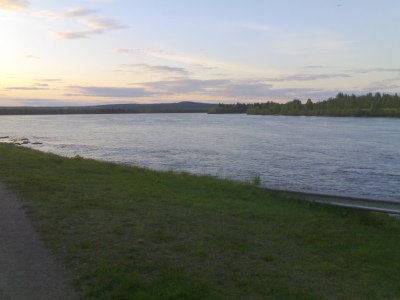
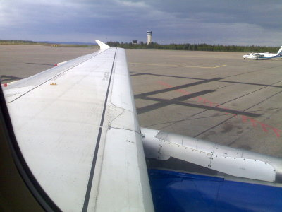

Keskiviikkoiltana loppuviikon työmatkalle vaihteeksi pohjoiseen, Rovaniemelle.

\[caption id="attachment\_1131" align="alignnone" width="400" caption="Embraer 190 odottaa illan matkustajia"\]\[/caption\]

Ounasjoki ja Kemijoki yhtyvät ja halkovat Rovaniemen kaupungin.

\[caption id="attachment\_1132" align="alignnone" width="400" caption="Rovaniemi, Ounasjoki ja Kemijoki"\]\[/caption\]

\[caption id="attachment\_1133" align="alignnone" width="400" caption="Silta Kemijoen yli"\]\[/caption\]

\[caption id="attachment\_1134" align="alignnone" width="400" caption="Pimeä ei tunnu tulevan vaikka ilta on jo pitkällä"\]\[/caption\]

\[caption id="attachment\_1135" align="alignnone" width="400" caption="Perjantaina kotia kohti Rovaniemen kentältä"\]\[/caption\]
