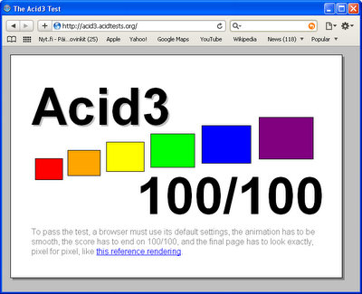

Selainrintamalla tapahtuu näinä aikoina. IE 8 julkaistiin keväällä, sitten Chrome 2,  ja nyt on Applen vuoro julkistaa uusin versio omasta Safari -selaimestaan, järjestyksessään versio 4.

Happotesti menee heittämällä läpi toisena näistä uusista jo julkistetuista. Ensiksi kerkisi Chrome 2. Samaa lupaa Opera 10, mutta se on vielä beta. Nähtäväksi jää Firefoxin 3,5 happotestin läpäisy, uusi kettu on kai seuraavana julkaisuvuorossa tänä kesänä. Joka tapauksessa Safarissa ja Cromessa on JavaScript -moottorit uusittuja, samaa tulee olemaan Firefoxissa ja Operassa. Vain IE 8 jäi reppanaksi tältä osin.

\[caption id="attachment\_1155" align="alignnone" width="400" caption="safari 4 ja acid3 testi"\]\[/caption\]

Nappaa omasi täältä [http://www.apple.com/safari/](http://www.apple.com/safari/).
