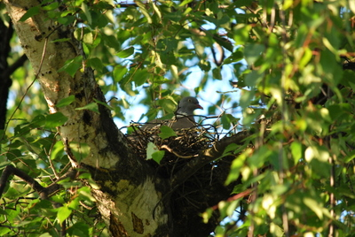

Sepelkyyhky on kyhännyt vaaatimattoman pesänsä takapihalla olevaan pihakoivuumme.

\[caption id="attachment\_1177" align="alignnone" width="400" caption="Sepelkyyhky hautoo risupesällään"\]\[/caption\]

Tätä täytyy seurata tarkemmin, kunhan poikaset varttuvat. Videokamera on valmiina ikuistamaan tulevia hetkiä, ellei peto vie poikasia tai saha puuta, kyllä maailma on vaarallinen paikka... Toivotaan kyyhkylle ja jälkeläisille mukavia kesiä jatkossakin.
