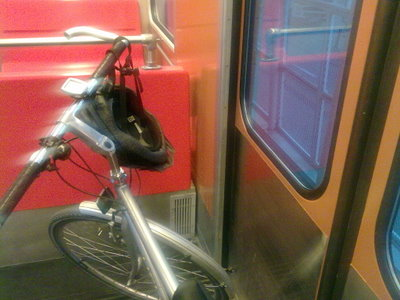
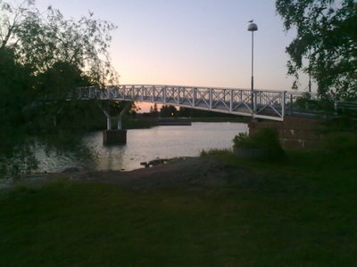
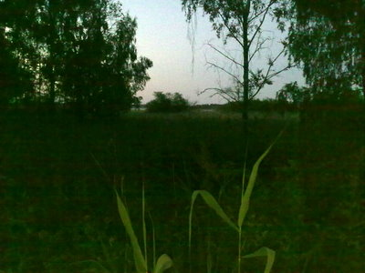
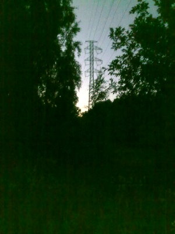
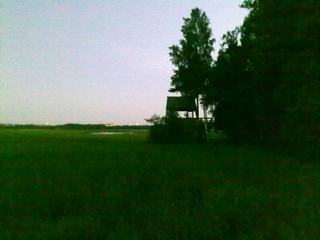
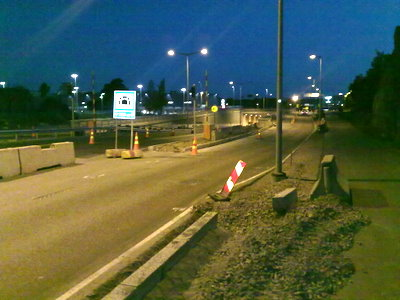

Torstain ja perjantain välinen yöllinen pyöräretki lintuja kuuntelemaan, reitti: Ruoholahti - Lauttasaari - Kaskisaari - Lehtisaari - Otaniemi - Laajalahti - Munkkiniemi - Pasila - Käpylä - Viikki - Puotinharju - Vuosaari.

Lintulajeja mm.: viitakerttunen, ruokokerttunen, satakieli, sarvipöllö

Sään suhteen oli mitä parhain kesäyö, tyyntä, pilvetöntä ja muutenkin rauhallista oli polkea välillä asfaltilla ja taas hiekalla ja metsäpoluilla. Satakielet ovat jo valtaosin hiljentyneet, mutta muita lintuja on kyllä äänessä. Kyllä kelpaa polkea muutenkin vaikka ei olisi lintujakaan, niin hieno on kesäyö kuin vain voi toivoa.

\[caption id="attachment\_1181" align="alignnone" width="400" caption="Metrolla Ruoholahteen"\]\[/caption\]

\[caption id="attachment\_1182" align="alignnone" width="400" caption="Lauttasaaren sillalta näkyy toinen Lauttasaaren silta"\]\[/caption\]

\[caption id="attachment\_1183" align="alignnone" width="400" caption="Kaskisaaren silta"\]\[/caption\]

Kaskisaaren jälkeen Lehtisaareen ja sieltä Otaniemeen. Muutamia satakieliä ja ruokokerttusia äänessä. Otaniemestä hiekkatietä pitkin kohti Villa Elfvikiä. Matkalla pari viitakerttusta ja satakieltä.

\[caption id="attachment\_1184" align="alignnone" width="400" caption="Viitakerttunen Laajalahden länsiosassa"\]\[/caption\]

Kuuntele: [viitakerttunen ja kehä 1](https://teuvovaisanen.fi/wp-content/uploads/2009/06/viitakerttunen-laajalahti-espoo-25-06-2009.mp3)

\[caption id="attachment\_1186" align="alignnone" width="300" caption="Viitakerttunen Laajalahden länsiosassa"\]\[/caption\]

Toisen viitakerttusen laulun äänitys on Kehä 1:n kohinan vuoksi niin kehno, että jätin julkaisematta.

\[caption id="attachment\_1187" align="alignnone" width="400" caption="Villa Elfvikin lintutorni"\]\[/caption\]

Kuuntele Villa Eflvikin ääniä, mm. [ruokokerttusia](https://teuvovaisanen.fi/wp-content/uploads/2009/06/villa-elfvikin-lintutornilla-26-06-2009.mp3)

Täältä matka jatkui kohti Munkkivuorta. Matkalla muutama satakieli, ruokokerttunen sekä sarvipöllön poikasia kerjäämässä ruokaa Ritokalliontiellä. [Kuuntele sarvipöllön poikasta](https://teuvovaisanen.fi/wp-content/uploads/2009/06/sarvipollo-ritokalliontie-munkkiniemi-26-06-2009.mp3).

\[caption id="attachment\_1188" align="alignnone" width="400" caption="Mannerheimin tien alittava tunneli on avattu"\]\[/caption\]

Aamulinnut ovat jo täydessä vauhdissa. Loppumatka sujui hissukseen polkemalla kohti Viikkiä, josta Puotinharjun kautta Vuosaareen veneelle nukkumaan.
