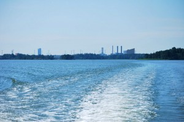
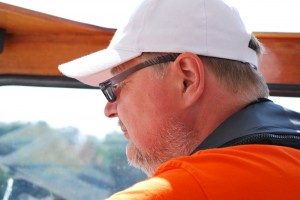

Ei ole liian myöhäistä aloittaa veneilyä heinäkuun puolessa välissä! Vielä kuukausi lomaa jäljellä. Kahden tunnin koeajo onnistui, kaikki tuntuu pelittävän, ennen kaikkea kone ei enää käy kuumana, COOL!

\[caption id="attachment\_1371" align="alignnone" width="300" caption="Haipakkaa kohti Helsingin itäosaa, Karhusaarta"\]\[/caption\]

\[caption id="attachment\_1372" align="alignnone" width="300" caption="Kapu"\]\[/caption\]

Kaikkea on riittänyt tälle "keväälle".  Pressu uusiksi, venelämmitin uusiksi, moottorin lauhdutusjärjestelmän täydellinen remontti, vetolaitteen palkeet jne. Mitäs sitten seuraavaksi?
