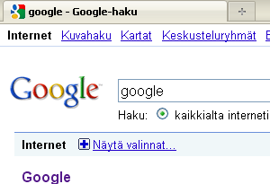
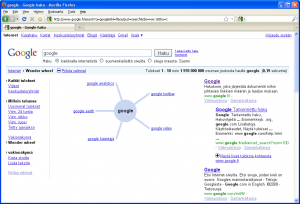

Vihdoin suomenkieliseenkin Google-hakuun [www.google.fi](http://www.google.fi) on lisätty ne ominaisuudet, jotka ovat olleet jo jonkin aikaa saatavilla www.google.com -osoitteessa! Uudet ominaisuudet saa näkyviin hakutulossivulla ylhäältä vasemmalta kohdasta **Internet - Näytä valinnat...** . Kannattaa kokeilla!

\[caption id="attachment\_1395" align="alignnone" width="300" caption="google internet näytä valinnat"\]\[/caption\]

Nyt mm. tuo mielenkiintoinen Wonder Wheel on käytössä, ehdottaen uusia hakuja ja näyttäen samalla hakutuloksia rinnalla.

\[caption id="attachment\_1393" align="alignnone" width="300" caption="uusittu google haku"\]\[/caption\]

Nyt myös aikaperustainen haku on entistä selvästi helpompaa.

Kaiken kaikkiaan erinomaisia parannuksia, Google rocks!
