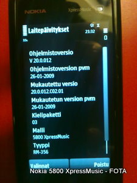
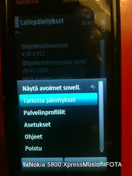
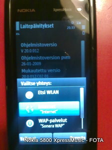
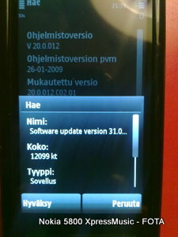
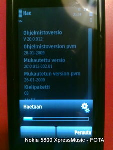
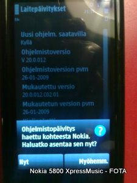
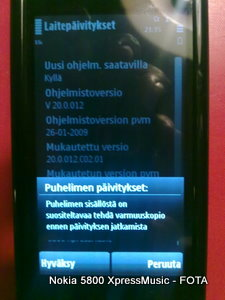
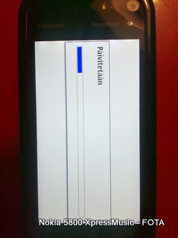

Hankin kesällä uuden puhelimen vuosia hyvin palvelleen Nokian N70 mallin tilalle. **Nokia 5800 XpressMusic** on ollut pelkästään positiivinen yllätys ja sen käyttö on ollut pääosin mutkatonta alun opettelujakson jälkeen. Mukavaa on myös puhelimen ohjelmiston päivittämisen helppous, sen voi tehdä suoraan puhelimesta ilman USB-liitäntää tietokoneeseen.

Valmistelut ovat perinteiset, kannattaa varmuuden vuoksi ottaa puhelimen tiedoista varmuuskopio. Sitten itse päivitykseen.

1. Varmista että puhelimessa on virtaa, laturi kiinni on hyvä idea
2. Varmista että puhelimen profiili on **Yleinen**
3. Naputtele numerosyötön avulla **\*#0000#** ja saat näytölle tiedot nykyisestä ohjelmistoversiosta
4. Valitse valikosta **Valitse - Tarkista päivitykset** ja sinulta kysytään Internet-yhteyttä, muodosta yhteys vastaamalla **Kyllä**
5. Puhelin ottaa yhteyden palveluun, jonka avulla selviää onko uutta ohjelmistoversiota tarjolla
6. Mikäli uutta on tarjolla, voit päivittää ohjelmiston samantien, aikaa menee vain muutama minuutti ainakin WLAN-yhteydellä (Welhon kaapeli)
7. Puhelin käynnistyy asennuksen jälkeen uudestaan, ja sitten ollankin valmiita

Todella mutkatonta ja onnistuu keneltä tahansa ilman insinööritutkintoa tai vierailua huoltoliikkeeseen.

Alkukesän jälkeen olen jo asentanut kaksi päivitystä, joten puhelimen ohjelmisto kehittyy koko ajan melko nopsaan.

[Lisätietoa Nokia 5800 XpressMusic -puhelimesta](http://www.nokia.fi/tuotteet/kaikki-puhelimet/nokia-5800-xpressmusic/tarkka-tuoteseloste).

Ohessa kuvakaappaukset tärkeimmistä vaiheista.

\[caption id="attachment\_1407" align="alignnone" width="225" caption="\*#0000# jälkeinen tilanne"\]\[/caption\]

\[caption id="attachment\_1411" align="alignnone" width="225" caption="Valinnat - Tarkista päivitykset"\]\[/caption\]

\[caption id="attachment\_1412" align="alignnone" width="225" caption="Valitse yhteystapa Internettiin"\]\[/caption\]

\[caption id="attachment\_1413" align="alignnone" width="225" caption="Hyväksy uusi ohjelmisto"\]\[/caption\]

\[caption id="attachment\_1414" align="alignnone" width="225" caption="Uusi ohjelmisto ladataan puhelimeen"\]\[/caption\]

\[caption id="attachment\_1415" align="alignnone" width="225" caption="Asenna samantien"\]\[/caption\]

\[caption id="attachment\_1416" align="alignnone" width="225" caption="Siitä vaan eteenpäin"\]\[/caption\]

\[caption id="attachment\_1417" align="alignnone" width="225" caption="Asennus meneillään, bootin jälkeen valmista"\]\[/caption\]
