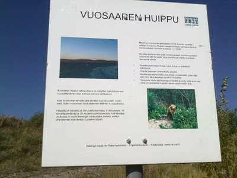
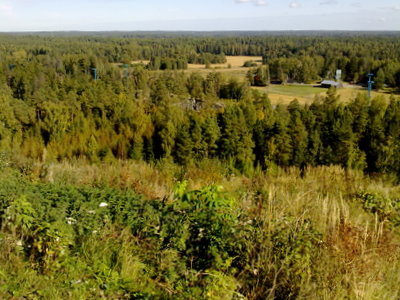
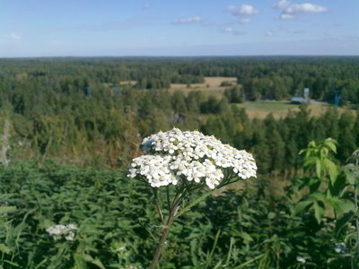

Tälläisenä päivänä väkeä riitti Vuosaaren huipulla, aka jätemäellä aka himalajalla. Tringa tai joku muu lintukerho taisi olla liikkeellä sillä pohjoisenpuolimmainen huippu oli täynnään kiikari. ja kaukoputkiväkeä, no kiikarithan minullakin sunnuntaitiirailijalla. Ulkoilijoita oli toinen mokoma, olisiko vajaa sata henkeä ollut näköpiirissä koko alueella.

\[caption id="attachment\_1426" align="alignnone" width="400" caption="Vuosaaren huippu"\]\[/caption\]

Valkoposkihanhia oli liikkeellä ja yksi merikotka kierteli kauempana idässä. Runsaasti perhosia rinteen pusikoissa ja oli todella lämmintä, ihan kuin kesällä.

\[caption id="attachment\_1427" align="alignnone" width="400" caption="Tätä on itäinen Helsinki"\]\[/caption\]

\[caption id="attachment\_1428" align="alignnone" width="400" caption="Monet kasvit ovat vielä täydessä kukassaan"\]\[/caption\]
