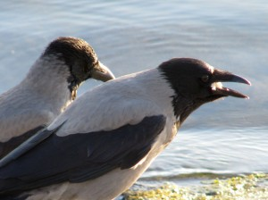
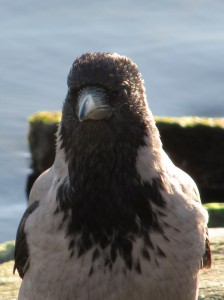
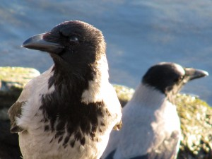

Perinteisen päiväkävelyn satoa uuden pokkarikameran kanssa. Viisi varista oli rannalla ruokaa etsimässä ja kesyjähän ne ovat kun pokkarillakin saa lintukuvia otettua. \[caption id="attachment\_1456" align="alignnone" width="300" caption="Kaksi wanhaa varista"\]\[/caption\]  
\[caption id="attachment\_1457" align="alignnone" width="224" caption="Variksen poseeraus"\]\[/caption\]  
\[caption id="attachment\_1458" align="alignnone" width="300" caption="Rantaelämää"\]\[/caption\]  

Melko hyvinhän tuon Canon PowerShot SX-200 IS:n linssi piirtää pokkariksi
