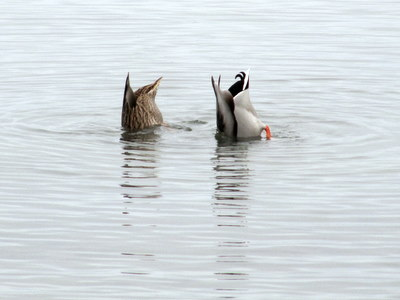
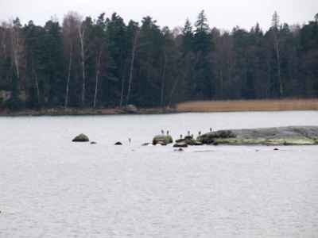
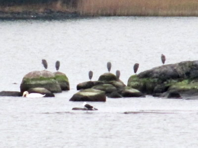

Merivesi on matalalla ja sorsilla on syötävää veden alla. \[caption id="attachment\_1469" align="alignnone" width="400" caption="Sinisorsat lounaalla"\]\[/caption\] Syksyn saapumisen huomaa myös siitä, että harmaahaikarat ilmestyvät kyhjöttämään Aurinkolahden edustalla olevalle luodolle. Viime talvena ne olivat meren jäätymiseen asti paikalla, niin varmaan tänäkin vuonna.

\[caption id="attachment\_1467" align="alignnone" width="400" caption="Harmaahaikarat luodolla - 12x optinen zoomi"\]\[/caption\]

Pidempi putki pitäisi olla jos aikoisi ottaa kunnon kuvia. 12 optinen zoomi tuottaa yleiskuvaa ja 48 kertainen ohjelmallinen zoomi pelkkää mössöä.

\[caption id="attachment\_1468" align="alignnone" width="400" caption="Harmaahaikarat luodolla - 48x ohjelmallinen zoomi"\]\[/caption\]
