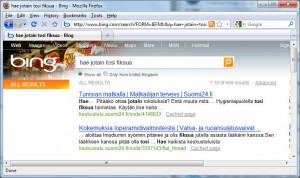
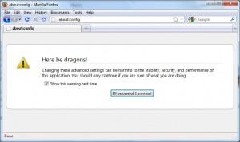
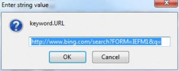
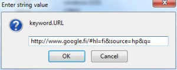

Firefox -selaimeen on integroitu hakukoneen hakutoiminnot. Oikeassa yläreunassa on hakuja varten omaa luukku ja käyttäjä voi vaihtaa hakukoneen helposti mieleisekseen.

Myös osoitekenttää voi käyttää hakuihin, kuten kuvassa. Oletusarvoisesti Firefox käyttää siinäkin Googlea, mutta joskus huonosti käyttäytyvät ohjelmat / palvelut ryöstävät toiminnon itselleen.

\[caption id="attachment\_1491" align="alignnone" width="300" caption="Firefox haku osoitekentästä"\]\[/caption\]

Pahus, mistä ihmeestä tuo Microsoftin Bing on onnistunut ryöstämään toiminnon itselleen?

\[caption id="attachment\_1492" align="alignnone" width="300" caption="Pahuksen Bing varastanut osoitekentän oletushakukoneominaisuuden"\]\[/caption\]

Raivostuttavaa, että jokin palvelu ottaa itselleen oikeuden muuttaa ohjelmien asetuksia kysymättä käyttäjältä mitään. Varmaan Microsoft Updaten tepposia tms. Se on korjattava ensi tilassa. Siispä töihin, googlettamaan.

Mozillan sivustolta löytyykin apua artikkelista osoitteessa [http://kb.mozillazine.org/Location\_Bar\_search](http://kb.mozillazine.org/Location_Bar_search)

Avataan siis Firefoxin asetukset kirjoittamalla osoitekenttään: `about:config`

\[caption id="attachment\_1494" align="alignnone" width="300" caption="about:config Firefox"\]\[/caption\]

Hyväksytään varoitus ja skrollataan alas kohtaan `keyword.URL` ja siellähän se "virhe" onkin.

\[caption id="attachment\_1495" align="alignnone" width="300" caption="keyword.URL"\]\[/caption\]

Kaksoisnapsauta tuota väärää Bing- osoitetta ja se avataan pop-up -ikkunaan.

\[caption id="attachment\_1496" align="alignnone" width="300" caption="väärä hakukone - se poistetaan"\]\[/caption\]

Muutetaan se siis oikeaksi korjaamalla  teksti alla olevan kuvan mukaiseksi.

\[caption id="attachment\_1497" align="alignnone" width="300" caption="oikea hakukone tilalle"\]\[/caption\]

Hyväksy OK ja sulje Firefox selain. Käynnistäessäsi selaimen uudestaan käyttää Firefox nyt Googlea, niinkuin ennenkin, hyvä niin!
