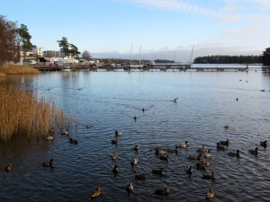
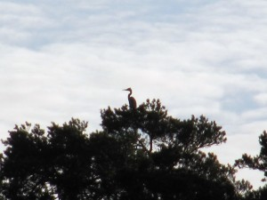

Kävelyretken kuvasatoa.

\[caption id="attachment\_1503" align="alignnone" width="300" caption="Pikku-Kallahti: VVK ja sinisorsat"\]\[/caption\]

Suurin osa veneistä on maissa, muutama iso purjevene taitaa talvehtia laiturissa edellisten vuosien tapaan. Sinisorsat pullajahdissa.

\[caption id="attachment\_1504" align="alignnone" width="300" caption="Harmaahaikara"\]\[/caption\]

Harmaahaikarat viihtyvät tähystyspaikoilla.
