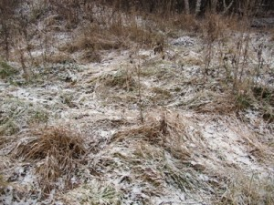
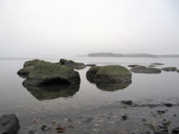
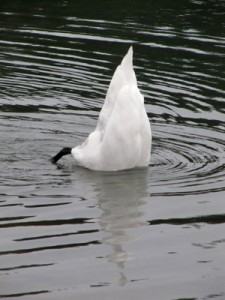
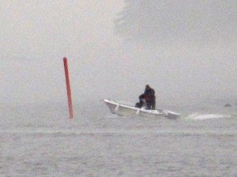
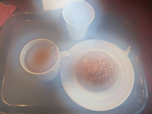

\[caption id="attachment\_1508" align="alignnone" width="300" caption="Melkein on talvi"\]\[/caption\]

Maa on hieman valkoisena ja se parantaa fiilinkiä.

\[caption id="attachment\_1509" align="alignnone" width="300" caption="Merellä on sumua"\]\[/caption\]

Pohjoisen puolelta tuulee, joten ranta on tyyni. Merellä aikamoinen usva.

\[caption id="attachment\_1510" align="alignnone" width="225" caption="Pullajoutsen vaihteeksi omin eväin"\]\[/caption\]

\[caption id="attachment\_1511" align="alignnone" width="300" caption="Aina kannattaa seistä veneessä sepalus auki"\]\[/caption\]

Köyhän miehen Flight-Bridge.

\[caption id="attachment\_1512" align="alignnone" width="300" caption="Utuinen Ullaksen unelma"\]\[/caption\]

Utu jatkuu sisällä, tosin linssin huurujen takia.
