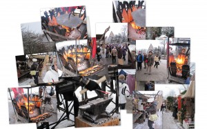

\[caption id="attachment\_1515" align="alignnone" width="300" caption="Menneen Ajan Joulumarkkinat"\]\[/caption\]

Sukkia, pipoja, kaulaliinoja, lakanoita, kynttilöitä, takorautaa, koruja, pipareita, valkosipulia, hirvimakkaraa, poromakkaraa, joulukoristeita, hernesoppaa, tirrimuikkuja, klapinkantokoreja, pärekoreja, pajukoreja, vietävästi myyntikojuja ja tuhottomasti ihmisiä.

Mukaan tarttui lammasmakkaraa herkkuhetkiin.
