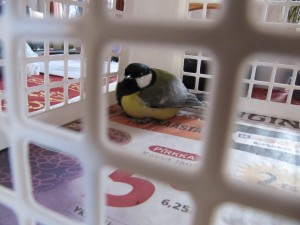
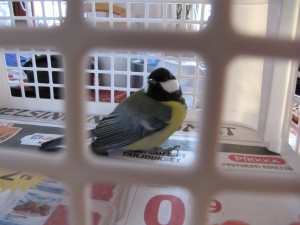
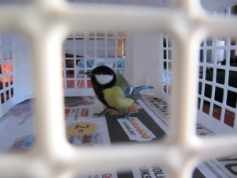
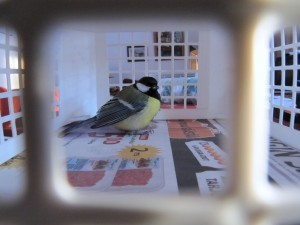

Talitiainen häkkilintuna. Ei, kyseessä ei ole lemmikki, vaan pelastusoperaatio.

Verannalla on muutama hiirenloukku ja talitiainen oli reppana jäänyt nokastaan yhteen niistä kiinni ja hytisi siellä kylmissään, onneksi osuin paikalle. Lintu irti ja näytti vahingoittumattomalta, oli vaan taju kankaalla ja kylmissään. Lämmitin sitä kämmenen sisällä ensin viitisen minuuttia ja sitten häkkiin heräilemään.

\[caption id="attachment\_1555" align="alignnone" width="300" caption="Talitiainen heräämässä"\]\[/caption\]

\[caption id="attachment\_1556" align="alignnone" width="300" caption="Missä mä olen?"\]\[/caption\]

\[caption id="attachment\_1557" align="alignnone" width="300" caption="Mitä toi yks tuolla sohii tuolla kameralla?"\]\[/caption\]

\[caption id="attachment\_1558" align="alignnone" width="300" caption="Hmmm - tylsää, tahtoo ulos!"\]\[/caption\]

Täytyy siirtää nämä hiirien avoloukot pois ja käyttää vain peitettyjä loukkoja jatkossa sillä tintit ovat uteliaita ja tutkivat jopa pöydänaluset jne. paikat ja tulevat pienistäkin raoista sisälle. Nyt ei onneksi käynyt pahasti, pääsipä sisään puoleksi tunniksi. Sinne se lensi puskaan säksättäen, oliko kiitos vai kirous?!
