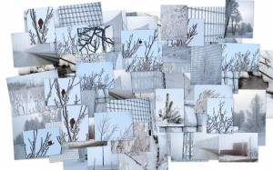
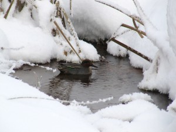
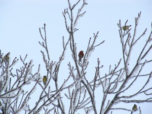
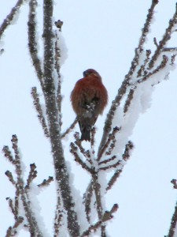

Näin talvisen näköistä ei Helsingissä ole ollutkaan vuosiin.

\[caption id="attachment\_1563" align="alignnone" width="300" caption="Kävelylenkin satoa - kollaasi"\]\[/caption\]

Ilma on tosi sumuinen, auringon valo kajasti huurun läpi välillä aavemaisesti.

Lintujakin näkyi mukavasti, taviuros oli jäänyt purolle talvehtimaan.

\[caption id="attachment\_1564" align="alignnone" width="300" caption="Tavi - Anas Crecca"\]\[/caption\]

Ruokinnalla oli kuhinaa, tiaisia, viherpeippoja ja joukossa myös yllätyksenä komea punainen taviokuurnauros.

\[caption id="attachment\_1565" align="alignnone" width="300" caption="Viherpeippoja ja taviokuurna"\]\[/caption\]

\[caption id="attachment\_1566" align="alignnone" width="225" caption="Taviokuurna - Pinicola Enucleator"\]\[/caption\]

[Lisää kuvia Picasawebissä](http://picasaweb.google.fi/stedivee/KavelylenkinSatoa#).
