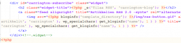

Ihan olisi kyllä ollut muutakin tekemistä, mutta juuri silloinhan iskee sivuproggikset kiinni. Oman sivuston kanssa on tullut laiskoteltua jo pidempään, mutta nyt sain aikaiseksi suomentaa Carrington-teeman php-tiedostot. Olkoon nyt koekäytössä jonkin aikaa, niin huomaa mikä teksti käyttöliittymässä alkaa harmittamaan ja vaatii korjausta.

\[caption id="attachment\_1581" align="alignnone" width="300" caption="Etsi englanninkielinen teksti ja korvaa suomenkielisellä"\]\[/caption\]
