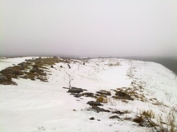

Pikainen linturetki Vuosaaren täyttömäelle. Aika tuulinen, sumuinen ja sateinen iltapäivä, mutta ei se tahtia haitannut. Lumen sulaminen on hyvässä vauhdissa.

\[caption id="attachment\_1608" align="alignnone" width="300" caption="Lumi sulaa"\]\[/caption\]

Alkajaisiksi portista oikealla olevan tien penkalla kuhisi maan tonkijoita ja pensaissa vipeltäjiä

- mustarastas: 4 koirasta 5 naarasta
- viherpeippo: 2 koirasta ja 3 naarasta
- talitiainen: 12
- sinitiainen: 4
- käpytikka: 1 koiras
- kulorastas: 1 (pitkästä aikaa)
- harakka: 1
- varis: 7

Rinnettä ylös ja tuuli yltyy, täällä ei juuri mikään liiku, paitsi

- korppi: 2
- varis: 4

Ja vihdoin väliin reiteen asti upottavassa hangessa ylöstarpomisen jälkeen odotti sumuinen ja kylmä huippu.

\[caption id="attachment\_1609" align="alignnone" width="300" caption="Huipulla tuulee"\]\[/caption\]

Sieltä alas tullessa ilahdutti

- hiirihaukka: 1 kiertelevä

Siis ihan kelpo saalis noin tunnin kävelyreissulta.
