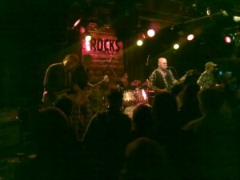

Wishbone Ashilla oli keikka Suomessa kymmenen vuoden tauon jälkeen. Erinomaista soitantaa hyvillä soundeilla.

\[caption id="attachment\_1590" align="alignnone" width="300" caption="Wishbone Ash"\]\[/caption\]

Keikan loppuvaiheessa lavalla nousi Muddy Mannisen rinnalle Ben Granfeldt. Lavalla siis Wishbone Ashin viimeisimmät suomalaiskitaravirtuoosit.

[Lisää kuvia Flickr:ssä](http://www.flickr.com/photos/stedi/).
