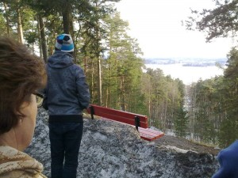
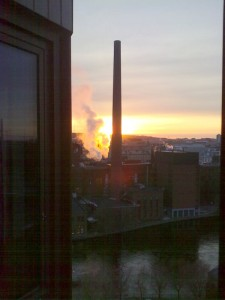

Yhdistetyn pääsiäs- ja talviloman kunniaksi aloitimme reissulla Tampereelle. Päätavoitteena H.R.Gigerin näyttely Tampereen taidemuseossa, sivuhupina hyvää ruokaa ja juomaa.

\[caption id="attachment\_1612" align="alignnone" width="300" caption="Keväinen ilta Pyynikin harjulla"\]\[/caption\]

Keli oli suosiollinen, kevättä ilmassa.

\[caption id="attachment\_1613" align="alignnone" width="225" caption="Ilta laskeutuu hotelli Ilveksessä"\]\[/caption\]

Ravintola Fransmanni oli seuraava kohteemme, ilta pitkän kaavan mukaan.

Hyvin nukutun yön jälkeen pientä ajanviettoa Tampereen keskustassa, kauppahallissa.

\[caption id="attachment\_1614" align="alignnone" width="300" caption="Aamupäivällä kauppahalliin"\]\[/caption\]

Sitten retken pääkohteeseen H.R.Gigerin näyttelyyn.

\[caption id="attachment\_1615" align="alignnone" width="300" caption="H.R.Giger näyttely"\]\[/caption\]

Valitettavasti sisällä ei kuvia saanut ottaa, mutta näyttely oli erinomainen. Näytillä oli mm. alkuperäisen elokuvan Alien -hahmo mekaniikkoineen.

Lisätietoa näyttelystä [Tampereen taidemuseon sivuilla](http://www.tampere.fi/taidemuseo/nayttelyt/hrgigerartdesignfilm.html).

Lisätietoa itse taiteilijasta H.R.Giger eri sivustoilta, kuten

- [en.wikipedia.org/wiki/H.\_R.\_Giger](http://en.wikipedia.org/wiki/H._R._Giger)
- [www.hrgigermuseum.com](http://www.hrgigermuseum.com)
- [www.hrgiger.com](http://www.hrgiger.com)
