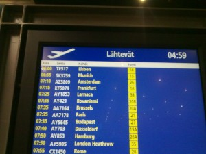
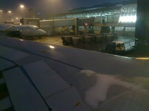
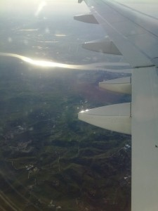
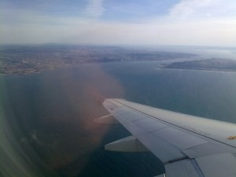
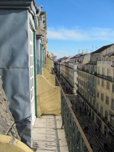
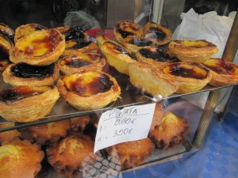
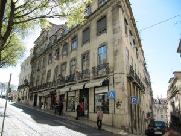
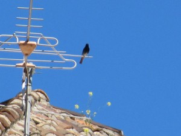

Aikainen herätys ja kentälle aamupalalle.

\[caption id="attachment\_1631" align="alignnone" width="300" caption="Suuntana Lissabon"\]\[/caption\]

Suuntana [Lissabon](http://fi.wikipedia.org/wiki/Lissabon) ja lähtö kello kuusi.

\[caption id="attachment\_1632" align="alignnone" width="300" caption="Kotimaan kelit"\]\[/caption\]

Aamuvarhaisella on vielä pimeää, eikä tuo sääkään ole mukava.

\[caption id="attachment\_1633" align="alignnone" width="225" caption="Tejo -joki"\]\[/caption\]

Suurin osa matkasta on jo taitettu, ollaan Portugalin ilmatilassa. [Tejo](http://fi.wikipedia.org/wiki/Tejo) -joki viekin suoraan Lissaboniin.

\[caption id="attachment\_1634" align="alignnone" width="300" caption="Lissabon näkyy jo"\]\[/caption\]

[TAP](http://www.flytap.com/Finland/en/Homepage/) :in Airbus käy kääntymässä meren päällä ja kaarramme takaisin kohti Lissabonin kenttää.

Sitten kentältä keskustaan ja hotelliin.

\[caption id="attachment\_1646" align="alignnone" width="225" caption="Näkymä hotellin parvekkeelta"\]\[/caption\]

\[caption id="attachment\_1638" align="alignnone" width="300" caption="Leivonnaiset"\]\[/caption\]

Kahvila- ja leipomokulttuuri on Lissabonissa voimakkaasti esillä.

\[caption id="attachment\_1639" align="alignnone" width="300" caption="Lissabonissa on mäkiä"\]\[/caption\]

Lissabon on rakennettu kukkuloille, kiivettävää riittää.

\[caption id="attachment\_1640" align="alignnone" width="300" caption="Mustaleppälintu"\]\[/caption\]

Lintumies on aina retkellä. Mustaleppälinnut viihtyvät talojen katoilla.

\[caption id="attachment\_1685" align="alignnone" width="300" caption="Illallinen kahdelle juomineen"\]\[/caption\]
