Toinen päivä aloitettiin sight-seeing ajelulla.

\[caption id="attachment\_1648" align="alignnone" width="225" caption="Yellow Line"\][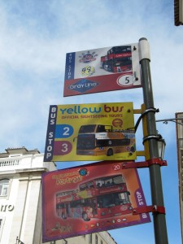](https://teuvovaisanen.fi/wp-content/uploads/2010/04/IMG_1290.jpg)\[/caption\]

Kiertoajelulla voi jäädä millä vaan pysäkillä pois ja katsella nähtävyyksiä. Sen jälkeen voi pysäkiltä hypätä takaisin seuraavaan bussiin ja jatkaa matkaa, kätevää.

\[caption id="attachment\_1649" align="alignnone" width="300" caption="Kukkulalta alas keskustaan päin"\][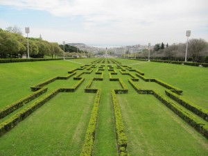](https://teuvovaisanen.fi/wp-content/uploads/2010/04/IMG_1308.jpg)\[/caption\]

\[caption id="attachment\_1650" align="alignnone" width="300" caption="Papukaija"\][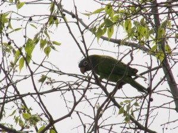](https://teuvovaisanen.fi/wp-content/uploads/2010/04/IMG_1316.jpg)\[/caption\]

Täytyy vielä selvittää mikä papukaijalaji on kyseessä.

\[caption id="attachment\_1651" align="alignnone" width="300" caption="Tower of Belem"\][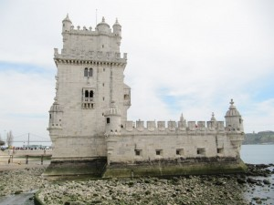](https://teuvovaisanen.fi/wp-content/uploads/2010/04/IMG_1332.jpg)\[/caption\]

\[caption id="attachment\_1652" align="alignnone" width="300" caption="Tower of Belem"\][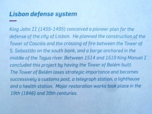](https://teuvovaisanen.fi/wp-content/uploads/2010/04/IMG_1367.jpg)\[/caption\]

\[caption id="attachment\_1653" align="alignnone" width="300" caption="Eurooppa"\][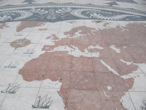](https://teuvovaisanen.fi/wp-content/uploads/2010/04/IMG_1389.jpg)\[/caption\]

Lissabonissa oli monin paikoin koristeellisia katukivetyksiä, tässä niistä yksi. Suomi-neitokin on päässyt mukaan.

Kiertoajelun jälkeen hieman jalkojen lepuuttelua ja herkkuja.

\[caption id="attachment\_1687" align="alignnone" width="300" caption="Kahvia ja omenapaakkelsia"\][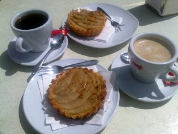](https://teuvovaisanen.fi/wp-content/uploads/2010/04/06042010953.jpg)\[/caption\]

Sitten isolle kukkulalle, jossa on linna. Linnan pihalta on todella upeat näkymät yli Lissabonin.

\[caption id="attachment\_1654" align="alignnone" width="300" caption="Appelsiinipuita omalla pihalla"\][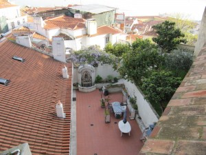](https://teuvovaisanen.fi/wp-content/uploads/2010/04/IMG_1414.jpg)\[/caption\]

\[caption id="attachment\_1655" align="alignnone" width="225" caption="Sao Jorge -linnoitus"\][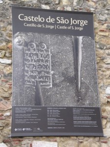](https://teuvovaisanen.fi/wp-content/uploads/2010/04/IMG_1406.jpg)\[/caption\]

\[caption id="attachment\_1656" align="alignnone" width="300" caption="Näkymä merelle Belemin suuntaan"\][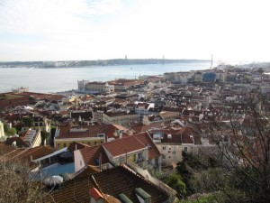](https://teuvovaisanen.fi/wp-content/uploads/2010/04/IMG_1423.jpg)\[/caption\]

\[caption id="attachment\_1658" align="alignnone" width="300" caption="Näkymä keskustaan"\][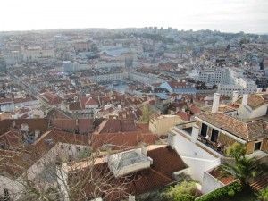](https://teuvovaisanen.fi/wp-content/uploads/2010/04/IMG_1444.jpg)\[/caption\]

\[caption id="attachment\_1659" align="alignnone" width="300" caption="Illallinen ravintolassa"\][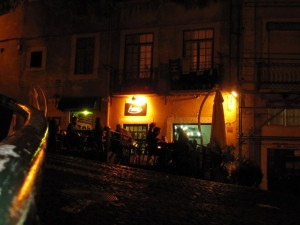](https://teuvovaisanen.fi/wp-content/uploads/2010/04/IMG_1489.jpg)\[/caption\]

Illallinen paikallisessa pienessä ravintolassa.

\[caption id="attachment\_1690" align="alignnone" width="300" caption="Alkupaloja"\][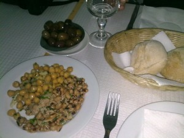](https://teuvovaisanen.fi/wp-content/uploads/2010/04/06042010960.jpg)\[/caption\]

\[caption id="attachment\_1689" align="alignnone" width="300" caption="Mutkattoman herkulliset sardiinit"\][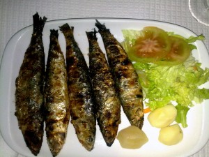](https://teuvovaisanen.fi/wp-content/uploads/2010/04/06042010961.jpg)\[/caption\]

\[caption id="attachment\_1661" align="alignnone" width="300" caption="Rautatie / metroasema"\][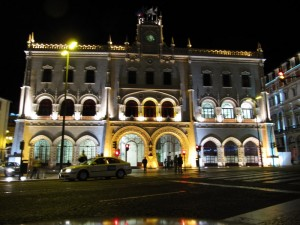](https://teuvovaisanen.fi/wp-content/uploads/2010/04/IMG_1499.jpg)\[/caption\]
