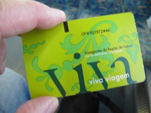
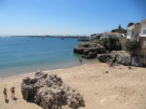
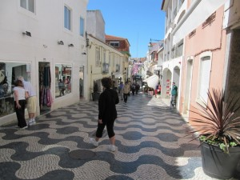
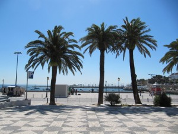
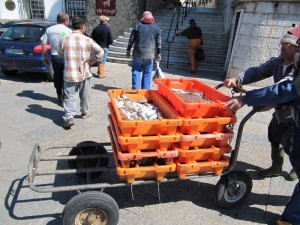
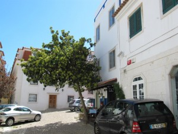
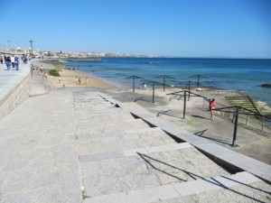

Kolmas päivä oli visiitti Cascaisiin. Junalippu ei paljoa maksanut.

\[caption id="attachment\_1665" align="alignnone" width="300" caption="Sähköinen junalippu"\]\[/caption\]

\[caption id="attachment\_1666" align="alignnone" width="300" caption="Uimaranta"\]\[/caption\]

\[caption id="attachment\_1667" align="alignnone" width="300" caption="Cascais katukuvaa"\]\[/caption\]

\[caption id="attachment\_1668" align="alignnone" width="300" caption="Keskustan aukealta merelle"\]\[/caption\]

\[caption id="attachment\_1669" align="alignnone" width="300" caption="Kalaa suoraan veneestä halliin"\]\[/caption\]

\[caption id="attachment\_1670" align="alignnone" width="300" caption="Lounasravintola"\]\[/caption\]

\[caption id="attachment\_1671" align="alignnone" width="300" caption="Kävellen Cascaisista Estoriliin"\]\[/caption\]

Estorilista junalla takaisin Lissaboniin. Illalla kävelyitä keskustassa.
