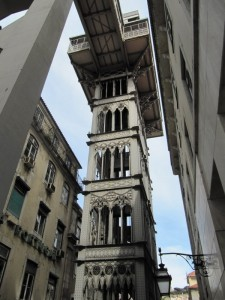
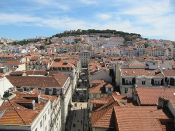
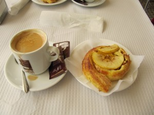
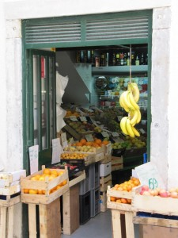
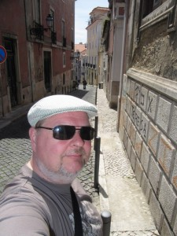
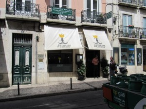
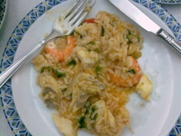
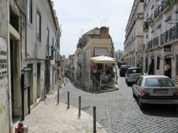
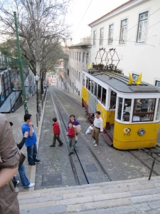
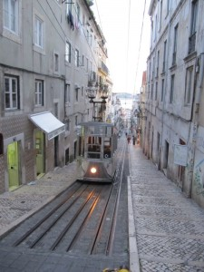

Neljäs päivä oli shoppailua ja kävelyä kukkuluilla. Korkeuserot olivat melkoiset, joten kaupungissa oli hissejä ja rinnettä pitkin meneviä raitiovaunuja helpottamaan liikkumista ylös.

\[caption id="attachment\_1675" align="alignnone" width="225" caption="Hissi yläkaupunkiin"\]\[/caption\]

\[caption id="attachment\_1676" align="alignnone" width="300" caption="Yläkaupungista kohti Sao Jorge -linnaa"\]\[/caption\]

\[caption id="attachment\_1677" align="alignnone" width="300" caption="Ei päivää ilman herkkuja"\]\[/caption\]

\[caption id="attachment\_1678" align="alignnone" width="225" caption="Tyypillinen putiikki"\]\[/caption\]

\[caption id="attachment\_1679" align="alignnone" width="225" caption="Vanhan kaupungit kadut"\]\[/caption\]

\[caption id="attachment\_1680" align="alignnone" width="300" caption="Lounaspaikka"\]\[/caption\]

Nälkähän siinä tulee kiipeillessä katuja ylös ja alas.

\[caption id="attachment\_1693" align="alignnone" width="300" caption="Katkarapu- kalapataa"\]\[/caption\]

Erinomaista valkoviinilla maustettua kalapataa.

\[caption id="attachment\_1681" align="alignnone" width="300" caption="Aina yksi ravintola mahtuu"\]\[/caption\]

\[caption id="attachment\_1682" align="alignnone" width="225" caption="Funicula"\]\[/caption\]

\[caption id="attachment\_1683" align="alignnone" width="225" caption="Funicula"\]\[/caption\]
