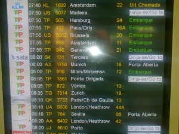
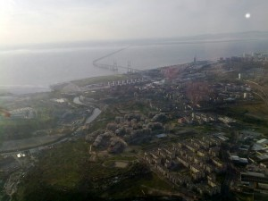
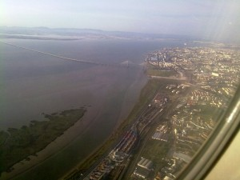
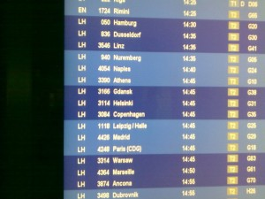

Viimeinen päivä olikin sitten matkustuspäivä. Aamulla aikaisin kentällä. Taksikuski oli vanha papparainen joka ajoi keskustassa 80 - 110 km/h.

\[caption id="attachment\_1700" align="alignnone" width="300" caption="Ensin Müncheniin"\]\[/caption\]

\[caption id="attachment\_1701" align="alignnone" width="300" caption="Toisella puolen ei keritty käymään"\]\[/caption\]

\[caption id="attachment\_1702" align="alignnone" width="300" caption="Näkemiin Lissabon"\]\[/caption\]

\[caption id="attachment\_1703" align="alignnone" width="300" caption="Münchenissa koneen vaihto"\]\[/caption\]

Sitten kohti Helsinkiä.
