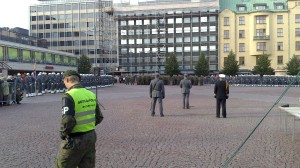
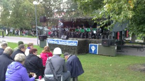

Nuorimmainen on par'aikaa suorittamassa asepalvelusta Santahaminassa. Palvelus osui Kaartin Jääkärirykmenttiin kuuluvan Kaartin Pataljoonan 200-vuotisjuhlavuoteen.  Tässä muutamia kuvia perinnepäiviltä.

\[caption id="attachment\_1837" align="alignnone" width="300"\] Vartion vaihto\[/caption\]

Kaartin jääkärit marssivat tilaisuuden jälkeen Helsingin Kasarmitorin ympäristössä ja suuntasivat Tähtitorninmäelle.

<iframe src="https://www.youtube.com/embed/d4UC0i_niYU" height="315" width="560" allowfullscreen frameborder="0"></iframe>

Marssin jälkeen oli Tähtitorninmäellä tarjolla Kaartin Soittokunnan konsertti sekä kevyttä tarjoilua kenttäkeittiöstä.

\[caption id="attachment\_1842" align="alignnone" width="300"\] Kaartin Soittokunta\[/caption\]

\[caption id="attachment\_1846" align="alignnone" width="300"\] Kaartin Jääkäri\[/caption\]

Lisätietoja: [Kaartin Jääkärirykmentti](http://www.puolustusvoimat.fi/kaartinjaakarirykmentti)
