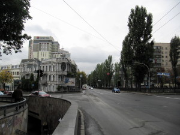
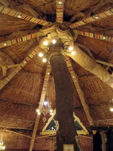
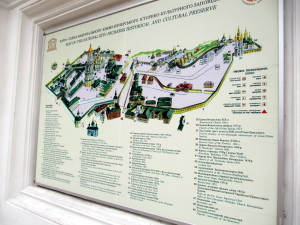
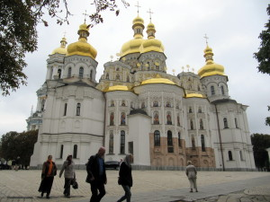
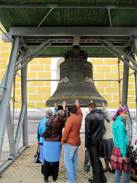
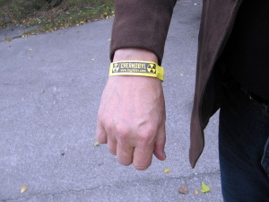
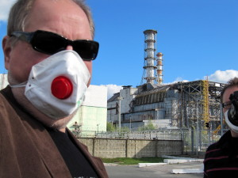
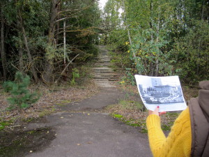

Kävimme syksyllä muutaman työkaverin kesken vapaa-ajan matkalla Ukrainassa. Pitkä viikonloppu, lähtö perjantaina iltapäivällä Helsinki-Vantaa lentoasemalta, paluu maanantai-iltana.

Asustimme Kiovassa yksinkertaisessa ja siistissä hotellissa: [Hotel Ibis Kiev Shevchenko Boulevard](http://www.ibis.com/gb/hotel-7143-ibis-kiev-shevchenko-boulevard/index.shtml) kävelymatkan etäisyydellä ns. ydinkeskustaa.

\[caption id="attachment\_1852" align="alignnone" width="300"\] Hotel ibis\[/caption\]

\[caption id="attachment\_1849" align="alignright" width="225"\] Puu ravintolan katossa\[/caption\]

Valuutta ei ollut euro, mutta oli helposti hallittavissa, pelkkä pilkun siirtäminen hinnoissa oli riittävä tarkkuus. Hintataso oli mukavan alhainen, ravintolassa hyvin syöminen oli kohtuuhintaista, ja sehän on mukavaa.

Tuloiltana hieman kaupunkikävelyä ja tietysti syömään, ravintolaan, jossa erikoisuutena oli elävä puu, joka kasvoi katon läpi.

 

 

 

Seuraavana päivänä kävimme mm. Unescon suojelemalla luostarialueella.

\[caption id="attachment\_1850" align="alignnone" width="300"\] Luostarialue\[/caption\]

\[caption id="attachment\_1856" align="alignnone" width="300"\] Eräs luostarin kirkoista\[/caption\]

\[caption id="attachment\_1857" align="alignnone" width="225"\] Kellolla on kuulemma parantava voima\[/caption\]

Seuraavana päivänä teimme retken Cherbonylin ydinvoimala-alueelle. Oma minibussi ja perillä oma opas. [Katso kaikki Chernobyl kuvat Picasasta](https://picasaweb.google.com/116444130678800061939/20120923ChernobylUkraine).

\[caption id="attachment\_1858" align="alignnone" width="300"\] Chernobyl huviranneke\[/caption\]

\[caption id="attachment\_1859" align="alignnone" width="300"\] Pahamaineinen reaktori 4\[/caption\]

\[caption id="attachment\_1862" align="alignnone" width="300"\] Pripyat ennen ja nyt\[/caption\]

Lauhdealtaissa kasvatetaan monneja, osa oli kasvanut jo aika jättiläisiksi. Oppaamme syötti niitä kuivalla leivällä.

<iframe width="560" height="315" src="https://www.youtube.com/embed/6FI_VT7pG6A" frameborder="0" allowfullscreen></iframe>
