Pitkä viikonloppureissu Berliiniin vaimon kanssa, lähtö perjantaiaamuna 9.11.2012 kukonlaulun aikaan Air Berlin ja Tegel. Paluu sunnuntai-iltana myöhään. Tegeliltä loistavat bussiyhteydet kaupunkiin kohtuuhinnalla, joskin kenttä on muuten palveluiltaan aika karu.

Asuimme vanhassa talossa sijaitsevassa hotellissa,  [Hotel Gates](http://www.hotel-gates.com/). Lähellä metrolinja 2 pysäkki sekä ravintoloita joka lähtöön.

\[caption id="attachment\_1865" align="alignnone" width="300"\][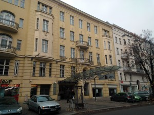](https://teuvovaisanen.fi/wp-content/uploads/2012/12/WP_000698.jpg) Hotel Gates\[/caption\]

Lähiravintoloista jäi mieleen jäi mm. pubi, jossa oli kissa nimeltä Zappa. Olihan se paikallista maistettava.

\[caption id="attachment\_1866" align="alignnone" width="225"\][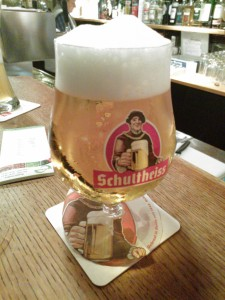](https://teuvovaisanen.fi/wp-content/uploads/2012/12/WP_000743.jpg) Paikallista pilsneriä - Schultheiss\[/caption\]

Ja tietenkin kun ensi kertaa Berliinissä käy (miten on jäänytkin väliin?), on turistipaikat koluttava.

 

\[caption id="attachment\_1867" align="alignnone" width="300"\][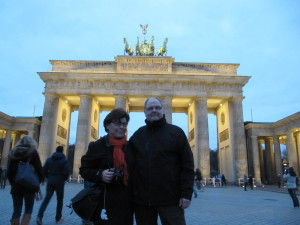](https://teuvovaisanen.fi/wp-content/uploads/2012/12/IMG_3617.jpg) Brandenburgin portti\[/caption\]

\[caption id="attachment\_1868" align="alignnone" width="300"\][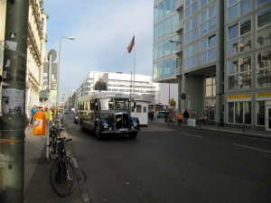](https://teuvovaisanen.fi/wp-content/uploads/2012/12/IMG_3625.jpg) Checkpoint Charlie\[/caption\]

\[caption id="attachment\_1869" align="alignnone" width="225"\][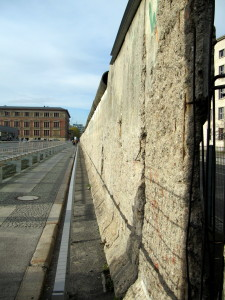](https://teuvovaisanen.fi/wp-content/uploads/2012/12/IMG_3635.jpg) Berliinin muuri\[/caption\]

\[caption id="attachment\_1878" align="alignnone" width="300"\][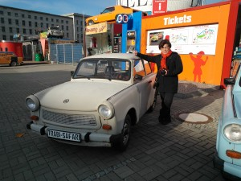](https://teuvovaisanen.fi/wp-content/uploads/2012/11/WP_000726.jpg) Lähdetkös ajelulle?\[/caption\]

 

Shoppailtua tuli etenkin vaatteita, hyvä että sai mahtumaan matkalaukkuihin. Hintataso sopiva. C & A ja Galeria Kaufhof tulivat tutuiksi ja KaDEWe myös, mutta sieltä ei mitään ostettu, se kun on hiukkasen kallis ;)

Lähtöpäivä vietettiin pääosin keskustassa sijaitsevassa eläintarhassa, joka oli mukava paikka.

\[caption id="attachment\_1872" align="alignnone" width="300"\][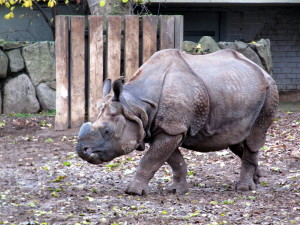](https://teuvovaisanen.fi/wp-content/uploads/2012/11/IMG_3642.jpg) Sarvikuono -laji\[/caption\]

\[caption id="attachment\_1873" align="alignnone" width="300"\][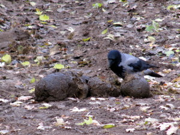](https://teuvovaisanen.fi/wp-content/uploads/2012/11/IMG_3643.jpg) Sarvikuonon sonta on herkkua\[/caption\]

\[caption id="attachment\_1874" align="alignnone" width="225"\][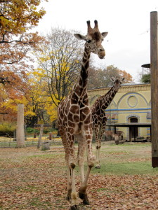](https://teuvovaisanen.fi/wp-content/uploads/2012/11/IMG_3653.jpg) Kirahvi\[/caption\]

\[caption id="attachment\_1875" align="alignnone" width="225"\][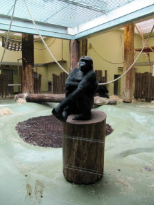](https://teuvovaisanen.fi/wp-content/uploads/2012/11/IMG_3663.jpg) Gorilla poseeraa\[/caption\]

\[caption id="attachment\_1876" align="alignnone" width="300"\][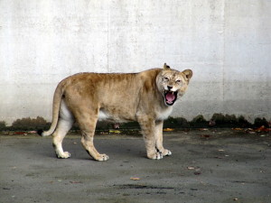](https://teuvovaisanen.fi/wp-content/uploads/2012/11/IMG_3688.jpg) Leijonanaaras vihaisena\[/caption\]

\[caption id="attachment\_1877" align="alignnone" width="300"\][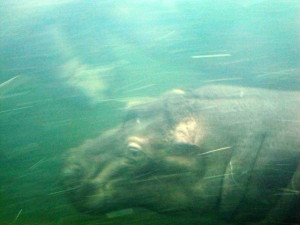](https://teuvovaisanen.fi/wp-content/uploads/2012/11/IMG_3716.jpg) Uiva Hippo\[/caption\]
